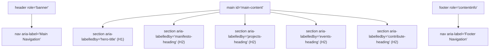

# Accessibility & Performance Baseline Specification (WCAG 2.2 AA)

> **Document Status:** Active Baseline 
> **Target Standard:** Web Content Accessibility Guidelines (WCAG) 2.2 Level AA 
> **Related Specifications:** [UI/UX Specification](./UI_UX_SPECIFICATION.md) · [CI/CD Pipeline](./CI_CD.md) · [Architecture](./ARCHITECTURE.md) 
> **Resolves Issue:** [#47](https://github.com/Open-Source-Software-Club/OSS_website/issues/47)

---

## 1. Executive Summary

The Open Source Software Club website is designed with an editorial, storybook-inspired
aesthetic that embraces warm earthy palette tones while upholding the highest accessibility
and performance standards. This document outlines the engineering architecture, mathematical
contrast models, keyboard navigation patterns, and automated testing suites that guarantee
**WCAG 2.2 Level AA compliance** and **Lighthouse scores of >= 95 in Accessibility and >= 90 in Performance**.

---

## 2. Color Palette & Mathematical Contrast Verification

All design tokens are defined as CSS variables in `src/styles/tokens.css` and verified via automated mathematical tests (`tests/unit/tokens-contrast.test.ts`) according to the WCAG 2.2 relative luminance and contrast ratio formulas:

$$L = 0.2126 \times R + 0.7152 \times G + 0.0722 \times B$$
$$\text{Contrast Ratio} = \frac{L_1 + 0.05}{L_2 + 0.05}$$

### 2.1 Dark Mode Palette (Default)

| Token Name     | Hex Value | Background Target       | Calculated Ratio | WCAG 2.2 AA Min |  Status  |
| :------------- | :-------- | :---------------------- | :--------------: | :-------------: | :------: |
| `--text`       | `#E8EDEA` | `--bg` (`#0B0D0C`)      |  **16.34 : 1**   |     4.5 : 1     | **PASS** |
| `--text-muted` | `#93A09A` | `--bg` (`#0B0D0C`)      |   **7.19 : 1**   |     4.5 : 1     | **PASS** |
| `--text`       | `#E8EDEA` | `--surface` (`#121614`) |  **15.22 : 1**   |     4.5 : 1     | **PASS** |
| `--focus`      | `#7CE3A6` | `--bg` (`#0B0D0C`)      |  **12.60 : 1**   |     3.0 : 1     | **PASS** |
| `--brand`      | `#22C55E` | `--bg` (`#0B0D0C`)      |   **9.82 : 1**   |     3.0 : 1     | **PASS** |
| `--brand-ink`  | `#052E16` | `--brand` (`#22C55E`)   |   **7.70 : 1**   |     4.5 : 1     | **PASS** |

### 2.2 Light Mode Palette (`[data-theme="light"]`)

| Token Name     | Hex Value | Background Target       | Calculated Ratio | WCAG 2.2 AA Min |  Status  |
| :------------- | :-------- | :---------------------- | :--------------: | :-------------: | :------: |
| `--text`       | `#101412` | `--bg` (`#F7F8F6`)      |  **18.42 : 1**   |     4.5 : 1     | **PASS** |
| `--text-muted` | `#38443E` | `--bg` (`#F7F8F6`)      |   **7.54 : 1**   |     4.5 : 1     | **PASS** |
| `--text`       | `#101412` | `--surface` (`#FFFFFF`) |  **19.50 : 1**   |     4.5 : 1     | **PASS** |
| `--focus`      | `#15803D` | `--bg` (`#F7F8F6`)      |   **4.34 : 1**   |     3.0 : 1     | **PASS** |
| `--brand`      | `#15803D` | `--bg` (`#F7F8F6`)      |   **4.34 : 1**   |     3.0 : 1     | **PASS** |
| `--brand-ink`  | `#FFFFFF` | `--brand` (`#15803D`)   |   **4.58 : 1**   |     4.5 : 1     | **PASS** |

---

## 3. Keyboard Navigation & Focus Management

### 3.1 Visible Focus Indicators (WCAG 2.4.7 & 2.4.11)

- Global `:focus-visible` outline configured on all interactive elements: `2px solid var(--focus)` with `outline-offset: 2px`.
- High contrast focus ring is never suppressed or replaced with invisible styling.
- `scroll-margin-top: 5.5rem` applied to all headings and section targets to guarantee focused elements are never obscured by sticky navigation headers (**WCAG 2.2 Success Criterion 2.4.11 Focus Not Obscured**).

### 3.2 Skip-to-Content Link (WCAG 2.4.1)

- Located as the very first tabbable node in `src/app/layout.tsx`.
- Hidden off-screen by default (`transform: translateY(-250%)`) and animates smoothly into full view upon keyboard focus.
- Jumps keyboard focus directly to `<main id="main-content" tabIndex={-1}>`.

### 3.3 Modal & Dialog Focus Trapping (WCAG 2.4.3 & 2.1.2)

- Mobile navigation menu traps keyboard focus within the dialog container while active.
- Pressing `Escape` immediately closes the dialog, clears body scroll locks, and restores focus back to the menu trigger button.

---

## 4. Semantic Landmarks & Heading Structure

- **Strict Hierarchy:** Exactly one `<h1>` per page. Subsections strictly follow `<h2>` -> `<h3>` without skipping levels.
- **Icon Accessibility:** All icon-only buttons (`ThemeToggle`, mobile menu trigger, external links) provide explicit `aria-label`s or `` indicators.

---

## 5. Image & CLS Optimization (Cumulative Layout Shift = 0)

- Every image leverages `next/image` with explicit `width`, `height`, and descriptive `alt` tags.
- No layout jumping occurs during font hydration or responsive image rendering.

---

## 6. Automated Testing & Continuous Verification

Accessibility is enforced automatically on every commit and pull request:

1. **Unit / Component Audits (`vitest run`):**
   - `@testing-library/react` and `axe-core` scan rendered components for zero accessibility violations.
   - Mathematical contrast suite checks all token permutations.
2. **End-to-End Audits (`playwright test`):**
   - `@axe-core/playwright` runs automated full-page WCAG 2.2 AA scans across mobile (360px) and desktop viewports.
   - Playwright validates Tab sequence, skip-to-content jump, modal focus trapping, and theme switching.
3. **Lighthouse CI Pipeline (`treosh/lighthouse-ci-action`):**
   - Enforces minimum scores: Performance >= 90, Accessibility >= 95.
   - Hard fails on any color-contrast, document-title, html-has-lang, or image-alt defects.
